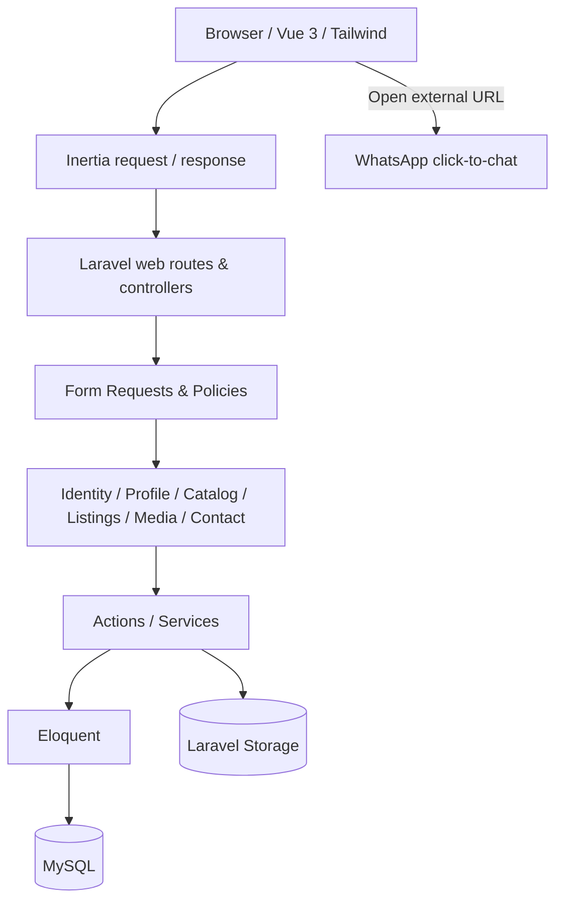
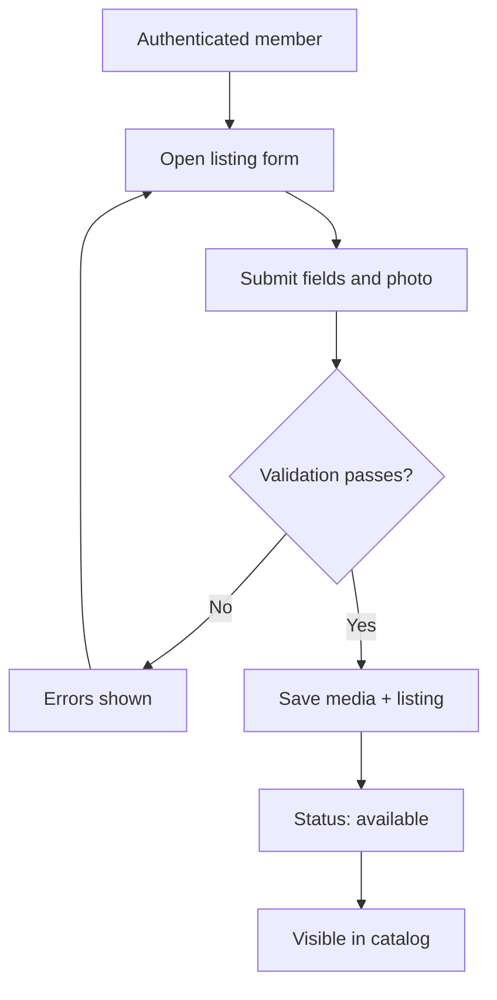

# 03 — Application Architecture

## Pattern
**Modular monolith:** one Laravel application, Inertia.js bridge, Vue 3 UI, MySQL database. Modules are logical boundaries, not separately deployed services.



## Module responsibilities
| Module | Owns | Does not own |
|---|---|---|
| Identity | Registration, login, logout, session | Listing rules |
| Profile | User information, user listings | Authentication internals |
| Catalog | Public index, search, filters, pagination, details | Listing mutations |
| Listings | Create/update/delete/status, ownership | WhatsApp delivery |
| Media | Image validation, storage paths, cleanup | Listing business rules |
| Contact | Build safe WhatsApp link from seller phone/item | Chat API |

## Request lifecycle
1. Browser navigates to a route.
2. Laravel authenticates where required, validates input, and authorizes mutation.
3. Controller/Action uses Eloquent to load or update data.
4. Inertia returns page component name and serializable props.
5. Vue renders responsive UI; subsequent interactions use Inertia requests.
6. WhatsApp CTA opens an external URL; no server-side WhatsApp API call.

## Important UI pages
- `Catalog/Index`: search, category/condition filters, grid, pagination, empty state.
- `Listings/Show`: image, title, price, description, condition, location, seller, status, WhatsApp.
- `Listings/Create`, `Listings/Edit`: validated form with image preview.
- `Listings/MyListings`: owner list, status and edit/delete controls.
- `Profile/Show` (or existing profile page): basic user data and owned listings.
- Auth pages from installed starter kit.

## UI design contract
Modern, clean, minimalist marketplace; Tailwind-based, mobile-first; clear navigation and CTA, readable typography, consistent spacing/radii, accessible focus/labels, responsive cards, loading/empty/error states. Exact pixel-perfect matching requires the approved mockup asset; none is embedded here.

## Folder conventions (proposed, not mandatory rewrite)
```text
app/
  Actions/Listings/
  Http/Controllers/
  Http/Requests/
  Models/
  Policies/
  Services/
resources/js/
  Components/
  Layouts/
  Pages/
routes/web.php
database/migrations/
tests/Feature/
```
Prefer conventional Laravel code over creating excessive layers for simple CRUD. One Action/Service only where shared or complex logic warrants it.

## Listing workflow


## Operational correctness
- Policies for ownership, not frontend-only checks.
- Pagination and eager loading (`user`, `category`, `images`) where appropriate.
- Keep queries in backend; do not query database from Vue.
- Return only necessary public seller fields to clients.
- Use redirect-after-mutation with flash success/error messages.
