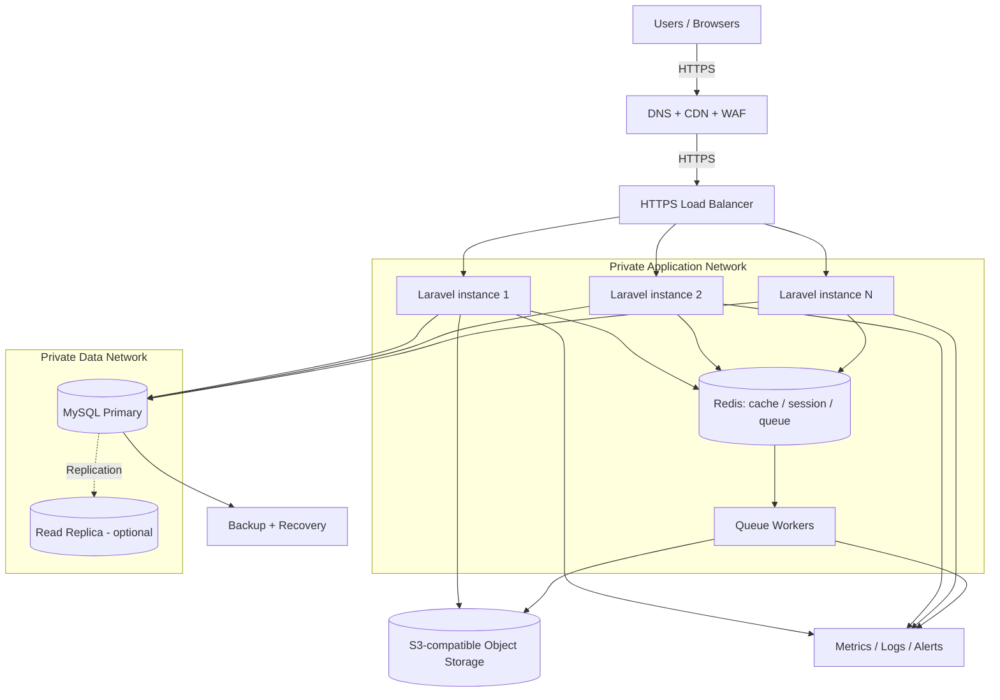

# 04 — Infrastructure Architecture (100K DAU Design)

> **Target architecture only.** GITS does not require deploying all these services for the one-day MVP.

## Component decisions
| Component | Proposed choice | Responsibility | Deployment stage |
|---|---|---|---|
| DNS/CDN/WAF | Cloudflare or equivalent | DNS, cache static assets/images, edge protection | Production |
| HTTPS load balancer | Managed ALB or equivalent | TLS, health checks, distribute traffic | Multi-instance production |
| Compute | Laravel on VM/container instances | PHP-FPM/Nginx, Inertia responses | MVP single instance → scale-out |
| Redis | Shared managed/self-hosted Redis | Session/cache/queue | Multi-instance production |
| Database | MySQL Primary | Authoritative transactional writes | MVP and production |
| Replica | MySQL read replica | Read scaling after profiling | Optional |
| Object storage | S3/R2 compatible | Shared images and backups where appropriate | Production |
| Monitoring | Metrics + centralized logs | Alerting and troubleshooting | Production |
| Backup | Scheduled + PITR where available | Recovery from failures | Production |

## Network and security boundaries
- Public internet reaches edge/CDN/WAF and HTTPS load balancer only.
- Application instances run in private subnets where possible.
- MySQL and Redis must not expose public ports.
- Object storage access controlled with IAM/least privilege; public media served via CDN or constrained public objects.
- Secrets via environment/secret manager; encrypted traffic and backups.
- Use TLS on user → edge and edge → load balancer; protect load balancer → app transport per network policy.
- Configure trusted proxies and secure cookies when TLS terminates upstream.

## Availability and scaling
- Health check endpoint should validate application readiness without exposing secrets.
- Multiple instances behind load balancer; sessions externalized to Redis.
- Queue workers separate long-running tasks (e.g. image processing).
- Scale on CPU, memory, request latency, and queue depth; not DAU alone.
- Replica and failover are not substitutes for backups.
- Frontend Vue assets are built by Vite and served as static files/CDN; Vue is not a separate server process in this Inertia design.

## External integration
WhatsApp click-to-chat is initiated by the browser. It is **not** a backend API dependency, and no WhatsApp credentials are needed.
