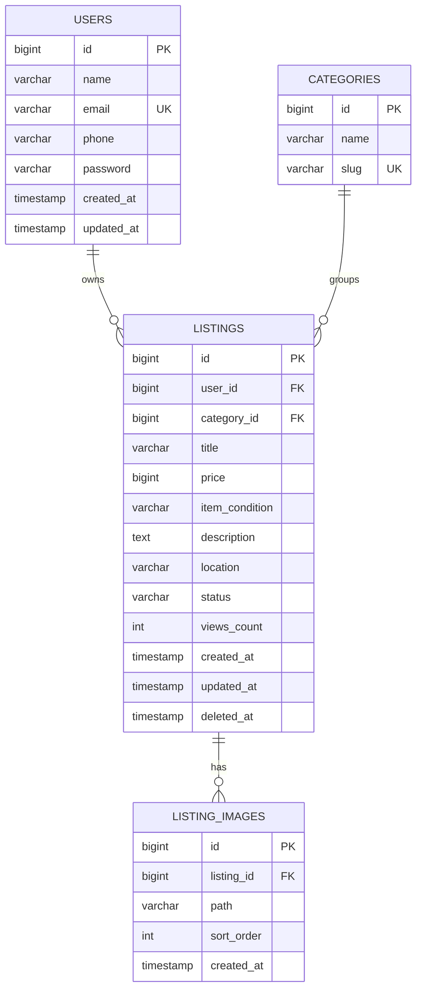

# 05 — Database Design (MySQL)

**Engine target:** MySQL 8.x InnoDB. **Implementation:** `database/migrations/2026_11_11_000001_create_marketplace_tables.php` extends the existing users table and adds categories, listings, and listing_images. The test suite uses SQLite in-memory. The four migrations and category seeder were also executed successfully on the configured local MySQL connection; this is a migration check, not a production load/compatibility benchmark.

## ERD

## Schema specification
### `users` (extend existing Laravel table)
| Field | Type | Rule |
|---|---|---|
| `id` | BIGINT UNSIGNED | PK |
| `name` | VARCHAR(255) | Required |
| `email` | VARCHAR(255) | Required, unique |
| `phone` | VARCHAR(20) | Nullable until seller publishes; normalized international digits |
| `password` | VARCHAR(255) | Hashed |
| timestamps | TIMESTAMP | Laravel standard |

### `categories`
| Field | Type | Rule |
|---|---|---|
| `id` | BIGINT UNSIGNED | PK |
| `name` | VARCHAR(100) | Required |
| `slug` | VARCHAR(120) | Unique |
| timestamps | TIMESTAMP | Optional but recommended |

Seed: bicycles, tools, hobbies, electronics, household goods (display names in Indonesian).

### `listings`
| Field | Type | Rule |
|---|---|---|
| `id` | BIGINT UNSIGNED | PK |
| `user_id` | BIGINT UNSIGNED | FK users.id |
| `category_id` | BIGINT UNSIGNED | FK categories.id |
| `title` | VARCHAR(200) | Required |
| `price` | BIGINT UNSIGNED | Whole IDR amount, >= 0 |
| `item_condition` | VARCHAR(20) | `new`, `like_new`, `good`, `fair` |
| `description` | TEXT | Required |
| `location` | VARCHAR(255) | Required; plain-text location |
| `status` | VARCHAR(20) | `available` or `sold`, default `available` |
| `views_count` | INT UNSIGNED | Default 0, incremented on detail visit |
| timestamps | TIMESTAMP | Required |
| `deleted_at` | TIMESTAMP NULL | Soft delete |

### `listing_images`
| Field | Type | Rule |
|---|---|---|
| `id` | BIGINT UNSIGNED | PK |
| `listing_id` | BIGINT UNSIGNED | FK listings.id, cascade delete |
| `path` | VARCHAR(500) | Storage-relative key |
| `sort_order` | INT UNSIGNED | Default 0 |
| timestamps | TIMESTAMP | Laravel standard |

The MVP form accepts one uploaded photo per listing, stored on Laravel's `public` disk. The images table can support more than one image later.

## Referential integrity
- `listings.user_id` → `users.id`: restrict deletion of users with listings unless explicit cleanup policy exists.
- `listings.category_id` → `categories.id`: restrict category deletion while referenced.
- `listing_images.listing_id` → `listings.id`: cascade physical deletion; soft deletion does not cascade automatically.
- Avoid duplicating seller phone into each listing unless business rules later require snapshots.

## Query and indexing plan
- `listings(user_id, created_at)`
- `listings(status, created_at)`
- `listings(category_id, status, created_at)`
- Consider `(item_condition, status)` after inspecting filter/query plans.
- MySQL `LIKE` for small MVP dataset; consider FULLTEXT index or external search when relevance/scale demands.
- Paginate; eager load category, owner, and primary image.
- Validate schema/indexes with `EXPLAIN` before adding speculative indexes.

## Data handling
- Store media **paths**, not binary images, in MySQL.
- Password hashing is handled by Laravel.
- Do not seed real user phone numbers or credentials.
- Preserve the starter kit's own auth/session/password-reset tables.
