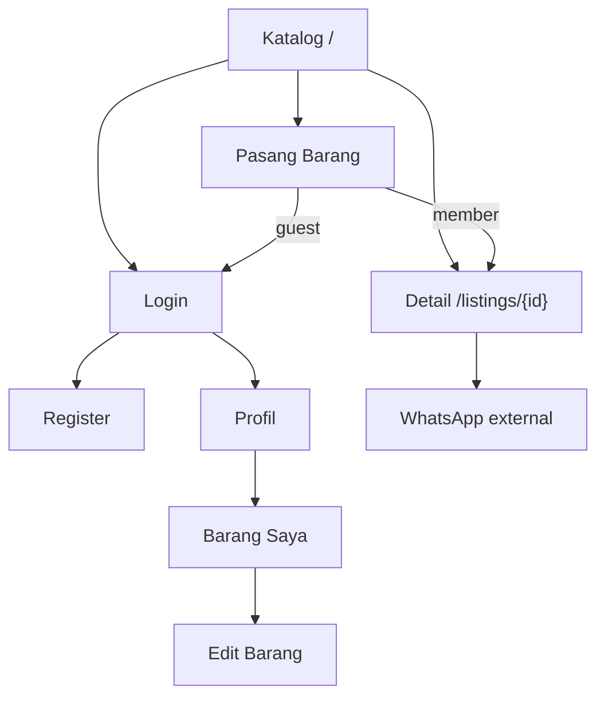

# 10 — Page Specifications & User Flows: Gudang Pakde

> **Status:** Page behavior specification for the GITS MVP, updated for the user's **Sellora reference**. Earlier wireframes describe functional content, not the final visual composition. All screens now use the neutral panel/pill design in `09-ui-ux-design-system.md`; no orders, analytics, marketing, or other out-of-scope dashboard features are added.
>
> **Route note:** URLs are proposed; check the existing Laravel/Breeze routes before implementation. Use Inertia pages, not a separate Vue SPA/API.

## 1. Navigation map



## 2. Global shell

**Header desktop:** floating white pill groups on a gray canvas: brand left, navigation center (`Katalog`, member `Barang Saya`, `Pasang Barang`) with dark active pill, search/account right. The account dropdown contains guest `Masuk/Buat akun` or member `Profil/Barang Saya/Keluar`; only real actions are present.

**Header mobile:** brand and account trigger on the first row, pill navigation below. Catalog search sits inside the content panel; posting stays discoverable. Account dropdown supports keyboard, Escape, and return focus.

**Footer:** short copyright/product text; no fake corporate/legal links. Main content has `max-w-7xl` container.

**Responsive baseline:** 360px, 768px, 1440px. All page copy in Bahasa Indonesia.

## 3. Catalog / Home

**Route:** `GET /` · **Access:** public · **Page:** `Catalog/Index`.

### Wireframe desktop
```text
┌─────────────────────────────────────────────────────────────────┐
│ Gudang Pakde       [Cari barang bekas...]   Jelajahi  + Pasang │
├─────────────────────────────────────────────────────────────────┤
│ Temukan barang bekas berkualitas dari komunitas                 │
│ [Search..............................] [Cari]                   │
│ [Semua kategori ▼] [Semua kondisi ▼] [Reset filter]             │
│ Barang terbaru                                    N barang      │
│ ┌────────────┐ ┌────────────┐ ┌────────────┐ ┌────────────┐    │
│ │ Foto 4:3   │ │ Foto 4:3   │ │ Foto 4:3   │ │ Foto 4:3   │    │
│ │ Judul      │ │ Judul      │ │ Judul      │ │ Judul      │    │
│ │ Rp ...     │ │ Rp ...     │ │ Rp ...     │ │ Rp ...     │    │
│ │ Kondisi    │ │ Kondisi    │ │ Kondisi    │ │ Kondisi    │    │
│ │ Lokasi     │ │ Lokasi     │ │ Lokasi     │ │ Lokasi     │    │
│ └────────────┘ └────────────┘ └────────────┘ └────────────┘    │
│                    [← Sebelumnya] [Berikutnya →]                │
└─────────────────────────────────────────────────────────────────┘
```

**Final composition:** compact catalog heading, count and working search/filter/post toolbar inside a large rounded white content panel. No marketing hero. Product cards use inset 4:3 imagery and full-width available/sold strips. **Mobile:** search full width; collapsible filters stack; 2-column cards where readable; pagination usable without overflow.

**Props:** paginated `listings`, `categories`, `filters`, optional `total` from query. **Cards:** image, title, price, condition, location, status. **Interactions:** search, filter category/condition, reset, click card, pagination. **States:** loading, no listings, no search results, missing image.

**Acceptance:** keyword + filters combine, query persists across pagination, only nondeleted listings shown, card details match DB, no N+1.

## 4. Listing detail

**Route:** `GET /listings/{listing}` · **Access:** public · **Page:** `Listings/Show`.

### Wireframe
```text
┌──────────────────────────────────────────────────────┐
│ Beranda / Kategori / Nama barang                      │
│ ┌────────────────────────┐  Judul barang              │
│ │                        │  Rp 1.250.000              │
│ │      FOTO UTAMA        │  [Tersedia] [Kondisi]      │
│ │                        │  Lokasi: Bandung           │
│ └────────────────────────┘  Penjual: Nama pengguna    │
│                             [Hubungi via WhatsApp]   │
│ Deskripsi barang                                     │
│ Teks deskripsi...                                    │
└──────────────────────────────────────────────────────┘
```

**Desktop:** two columns (image left, details right). **Mobile:** single column, image above info, CTA full width.

**States:** available/sold, missing contact, missing image, 404. **Actions:** WhatsApp external link; owner edit link optional. **Acceptance:** correct seller data, description escaped, contact link valid, sold state clear. Default sold behavior: contact CTA disabled with explanation (see design system).

## 5. Login and Register

**Routes:** existing auth routes · **Access:** guest · **Pages:** installed auth components.

**Layout:** premium rounded white authentication panel on gray canvas, with restrained brand/editorial column on desktop and a single form column on mobile. Charcoal CTA, labeled inputs, violet focus, and working alternate-auth links. Existing starter-kit authentication behavior is preserved, not its default visual styling.

**Login:** email, password, remember-me if already supported, submit, link to register.  
**Register:** name, email, password, confirmation; phone may be collected at profile stage.  
**States:** invalid credentials, validation, pending, redirect on success.

**Acceptance:** auth works; protected pages redirect guest; no fake OAuth buttons; error messages accessible.

## 6. Profile

**Route:** `GET /profile` (reconcile with existing starter) · **Access:** member.

**Sections:** profile summary (name, email, WhatsApp number), link to edit account info if starter supports it, and **Barang yang Saya Pasang** preview/list. No need for avatar upload or complex settings.

**Acceptance:** only own listings shown; member can see/maintain contact number needed for WhatsApp CTA; sensitive fields not exposed to other users.

## 7. My Listings

**Route:** `GET /my-listings` · **Access:** member · **Page:** `Listings/MyListings`.

**Desktop:** compact cards or simple list with photo, title, price, status, updated date, and actions. **Mobile:** stacked cards.

**Actions:** `Edit`, `Tandai Terjual` / `Tandai Tersedia`, `Hapus` (confirmation dialog).  
**States:** no listings (“Belum ada barang yang dipasang”), processing status, delete confirmation, error/success flash.

**Acceptance:** only owner's listings; mutation policy enforced server-side; sold status updated in public catalog; deletion removes item from public listing.

## 8. Create Listing

**Route:** `GET /listings/create`, `POST /listings` · **Access:** member · **Page:** `Listings/Create`.

**Form order:**
1. Nama barang (required)
2. Kategori (required)
3. Harga dalam IDR (required, integer >= 0)
4. Kondisi (required; Baru, Seperti Baru, Bagus, Cukup)
5. Lokasi (required)
6. Deskripsi (required)
7. Foto (required, JPEG/PNG/WebP up to 2 MB proposed)
8. `Pasang Barang` CTA and `Batal`

**Layout:** shared full-width two-column white panel on desktop: large image preview/upload on the left, complete listing details on the right, save/cancel footer. Stacks on mobile/tablet with a capped preview height. One photo remains the MVP limit; no fake multi-image gallery. **States:** initial, invalid, uploading/processing, success, upload failure.

**Acceptance:** server validation, seller contact requirement, safe upload, duplicate-submit prevention, redirect to detail or my listings on success.

## 9. Edit Listing

**Route:** `GET /listings/{listing}/edit`, `PUT/PATCH /listings/{listing}` · **Access:** owner only · **Page:** `Listings/Edit`.

Reuse create form with initial values. Existing photo visible and retained unless replaced. Status is changed via dedicated action on My Listings, not necessarily duplicated in edit form.

**Acceptance:** 403 for nonowner, 404 for missing listing, validation error preserves inputs, successful update reflected in catalog/detail.

## 10. State & error matrix

| Context | Trigger | UI behavior |
|---|---|---|
| Catalog | No records at all | “Belum ada barang” + post CTA for member |
| Catalog | Search returns zero | “Tidak ada barang yang cocok” + reset filters |
| Detail | Listing missing/deleted | Friendly 404 page |
| Detail | Sold | “Terjual” badge; contact disabled with explanation |
| Detail | No valid phone | “Kontak penjual belum tersedia” |
| Form | Invalid fields | Inline messages + focus first invalid input |
| Form | File invalid/too large | Explain allowed formats/size |
| Form | Saving | Button disabled, processing label |
| My Listings | No owned items | “Belum ada barang yang dipasang” + CTA |
| Delete | User initiates | Confirmation dialog; explicit cancel |
| Delete | Success | Redirect/refresh + success feedback |
| Auth | Session expired | Redirect to login; no destructive retry |

## 11. User journeys and test scenarios

### Browse and contact
1. Guest opens catalog.
2. Searches “sepeda” and filters condition “Bagus”.
3. Opens a result; reads details and seller information.
4. Clicks WhatsApp; browser opens prefilled contact message.
**Success:** no login required for browse/contact, filters work, link contains correct listing reference.

### Sell a product
1. Member signs in.
2. Opens Pasang Barang.
3. Completes fields, uploads photo, submits.
4. Sees success and new listing in public catalog/My Listings.
**Success:** listing belongs to member, has valid image, status `available`.

### Manage listing
1. Member opens Barang Saya.
2. Edits price; marks item sold; optionally deletes.
3. Another account tries to edit the same item by URL.
**Success:** owner changes persist, nonowner receives 403, deleted item is not public.

## 12. Page-by-page implementation order

1. Shared layout/header, design tokens.
2. Catalog + listing card + filters.
3. Detail + WhatsApp CTA.
4. Create/edit forms + image preview.
5. My Listings + status + delete.
6. Profile integration.
7. Auth styling and cross-device QA.

## 13. UI/UX definition of done

- [ ] All eight screen groups exist and match planned functionality.
- [ ] Tailwind tokens/spacing and typography are consistent.
- [ ] Desktop and mobile layouts tested (360/768/1440px).
- [ ] Clear focus, labels, error states, and loading feedback.
- [ ] Status, price, location, condition, seller info accurately displayed.
- [ ] No checkout, payment, ratings, reviews, chat, AI, or unnecessary admin.
- [ ] Agent provides screenshots for visual review if tooling permits.
- [ ] Visual review against the supplied Sellora screenshot for composition, surfaces, typography and spacing; no claim of pixel-perfect reproduction.
